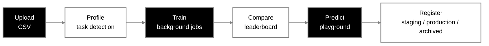
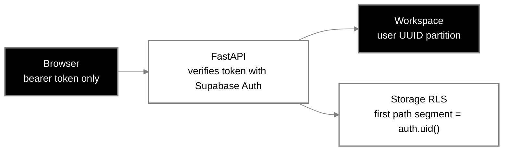
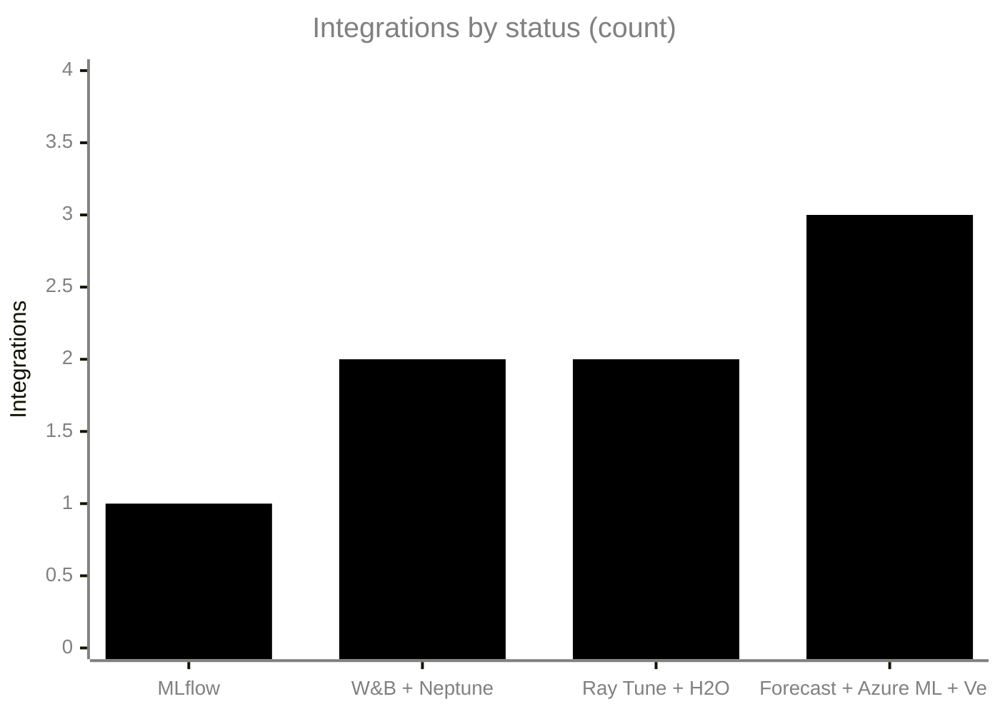
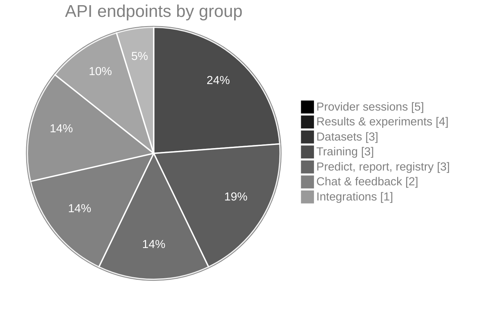

<div align="center">


<br/>
<br/>

# 🧠 KATNYO AI — Structured Data, Made Clear

**A beta AutoML workspace for structured CSV data.**

Profile datasets, train and compare models, explore predictions, and manage experiments in one workspace.

**CSV profiling · AutoML training · Model comparison · Predictions · Experiment tracking**

<br/>


<br/>

<table>
  <tr>
    <td align="center"><b>6</b><br/><sub>AI providers</sub></td>
    <td align="center"><b>3</b><br/><sub>AutoML task types</sub></td>
    <td align="center"><b>21</b><br/><sub>API endpoints</sub></td>
    <td align="center"><b>12 h</b><br/><sub>in-memory key lifetime</sub></td>
    <td align="center"><b>3</b><br/><sub>registry labels</sub></td>
  </tr>
</table>

<br/>

<a href="#-features">Features</a> ·
<a href="#-quick-start">Quick Start</a> ·
<a href="#%EF%B8%8F-local-development">Local Dev</a> ·
<a href="#-provider-sessions">Providers</a> ·
<a href="#%EF%B8%8F-supabase-accounts-and-storage">Supabase</a> ·
<a href="#%EF%B8%8F-configuration">Config</a> ·
<a href="#-api">API</a> ·
<a href="#-limits">Limits</a> ·
<a href="#%EF%B8%8F-screenshots">Screenshots</a>

</div>

## 🔄 Workflow



## ✨ Features

- CSV upload, profiling, task detection, and dataset revision history
- Classification, regression, and time-series AutoML with Optuna and available model candidates
- Background training jobs with progress polling
- Model leaderboard and cross-run experiment comparison
- Prediction playground for saved model artifacts
- Downloadable Markdown training reports
- Local model registry with staging, production, and archived labels
- Dataset profile chat using local rules or a connected AI provider
- Optional Supabase email/password accounts with UUID-isolated workspaces
- Private Supabase Storage uploads protected by per-user folder policies
- MLflow tracking, with optional W&B and Neptune logger adapters
- SHAP explanations with feature-importance fallback
- Provider key entry, connection checks, per-provider clearing, and session-wide clearing

## 🚀 Quick Start

Docker is the simplest local setup and does not require adding AI provider keys to `.env.example` or editing an environment file:

```powershell
docker compose up --build -d
```

Follow service logs with `docker compose logs -f`, and stop the local stack with `docker compose down`.

| Service | URL |
| --- | --- |
| Landing page | `http://localhost:5173` |
| AutoML console | `http://localhost:5173/console.html` |
| FastAPI docs | `http://localhost:8000/docs` |
| Health | `http://localhost:8000/health` |

The landing page is `frontend/index.html`, a single HTML file with inline CSS and JavaScript. Provider keys are added from its **Open a session** dialog. The console at `/console.html` asks customers to sign in when Supabase is configured.
The provided KATNYO AI artwork appears only on the landing and branded 404 page. Unknown routes return an actual HTTP 404, and the AutoML console uses a monochrome theme.

## 🛠️ Local Development

### Backend

Use Python 3.11, then run from `backend`:

```powershell
py -3.11 -m venv .venv
.\.venv\Scripts\Activate.ps1
python -m pip install -r requirements.txt
uvicorn main:app --reload --host 0.0.0.0 --port 8000
```

### Frontend

In another terminal:

```powershell
cd frontend
npm install
npm run dev
```

Open the Vite URL, normally `http://localhost:5173`; the console is at `/console.html`. The HTML page calls the API on the same hostname at port `8000` by default. Set `window.KATNYO_API_URL` before the inline script if your API is hosted elsewhere.

## 🔐 Provider Sessions

The session dialog supports OpenAI, Azure OpenAI, Google Gemini, Anthropic Claude, Hugging Face Inference, and Cohere. Choose a provider, paste a key, and use **Save & test**. Azure OpenAI also requires its HTTPS resource endpoint and deployment name; an optional model override is available for other providers.

The browser stores only a random session ID in `sessionStorage`; it does not save the API key. The FastAPI process holds keys in memory for up to 12 hours. Keys are not returned by status endpoints or written to disk. Clear an individual provider or end the session from the dialog. Restarting the backend clears every session key. The API server receives the key, so only connect to a backend you trust. This in-memory scheme is intended for a local beta, not a multi-user public deployment.

If OpenAI reports HTTP 401, the provider rejected the supplied credential. Re-enter an active API key in the provider dialog and choose **Save & test**; the saved status alone does not mean the key was verified. Never paste API keys into chat or support messages. HTTP 403 indicates denied access, 404 points to a model or endpoint setting, and 429 indicates a rate or quota limit.

| Code | Meaning |
| --- | --- |
| `401` | Provider rejected the supplied credential |
| `403` | Access denied |
| `404` | Model or endpoint setting |
| `429` | Rate or quota limit |

Dataset chat sends the dataset profile and question to the selected provider, not raw CSV rows. The local provider uses profile rules and needs no API key.

## ☁️ Supabase Accounts And Storage

Supabase is optional for local exploration. Without Supabase settings, KATNYO AI uses its existing local demo workspace, which is shared and is **not suitable for customer data**. To enable customer accounts and tenant isolation:

1. Create a Supabase project. In **Authentication > Providers**, enable Email. Configure the site URL and allowed redirect URL to include `http://localhost:5173/console.html` for local testing. Keep email confirmation enabled for real users.
2. In **Storage**, create a private bucket named `katnyo-user-data`. Allow CSV uploads (`text/csv` and `application/octet-stream`) and set an upload size limit that matches your deployment.
3. Open the Supabase SQL editor and run [`supabase/storage_policies.sql`](supabase/storage_policies.sql). The policies restrict read, upload, update, and delete to objects whose first path segment equals the authenticated user's `auth.uid()`.
4. Copy `.env.example` to `.env`. Set `SUPABASE_URL` and `SUPABASE_PUBLISHABLE_KEY` from the Supabase project API settings. Set `VITE_SUPABASE_URL` and `VITE_SUPABASE_PUBLISHABLE_KEY` to the same values, then rebuild:

   ```powershell
   docker compose up --build -d
   ```

   The project URL and publishable key are designed for client use. **Do not put a Supabase service-role/secret key in the browser or this app's configuration.** The backend verifies each bearer token against Supabase Auth and forwards that user's token to Storage; it never trusts a user ID or email sent by the browser.

5. Open `http://localhost:5173/console.html`, create an account, confirm the email if requested, and sign in. A customer's email is only the display/login identity; their immutable Supabase user UUID is the workspace and Storage folder boundary. Each account's datasets, jobs, model artifacts, revisions, feedback, and registry are kept in a separate backend workspace.

### Tenant isolation




Until both frontend Supabase values are present at build time, the console intentionally stays in local-demo mode. Its banner and **Integrations > Accounts & storage** section show which setup is missing; the sign-in/create-account screen appears at `/console.html` after the frontend is rebuilt with the project URL and publishable key.

Local Vite development reads `VITE_SUPABASE_URL` and `VITE_SUPABASE_PUBLISHABLE_KEY` from `frontend/.env.local` (or the shell environment). The backend also needs `SUPABASE_URL` and `SUPABASE_PUBLISHABLE_KEY`. Supabase auth is automatically required whenever either backend setting is present; `KATNYO_AUTH_REQUIRED=true` can explicitly fail closed when credentials are missing.

Uploads are stored in the private bucket under `<user UUID>/<dataset>/<revision>/<filename>` and also copied to that user's local processing workspace. The account separation is enforced by the API and Storage RLS, not by email-based folder names. Do not expose the backend's local storage volume or MLflow tracking service directly to customers.

## ⚙️ Configuration

Copy `.env.example` to `.env` to configure local row limits, tracking locations, model defaults, or Supabase. It contains no AI-provider API keys. OpenAI, Azure OpenAI, Gemini, Anthropic, Hugging Face, and Cohere keys continue to be entered in the provider session dialog, not in environment files.

MLflow is used by training when installed. W&B and Neptune have optional tracking adapters and can be installed with `python -m pip install -r requirements-integrations.txt` from `backend`; their credentials are still server-side configuration and are intentionally not requested by the AI provider dialog. Ray Tune and H2O are status flags only. Amazon Forecast, Azure Machine Learning, and Vertex AI are not training adapters yet; listing their configuration does not enable those services.

### Integration status (8 listed)

```text
Used in training (MLflow)                  ███░░░░░░░░░░░░░░░░░░░░░░  12.5%
Optional adapters (W&B, Neptune)           ██████░░░░░░░░░░░░░░░░░░░  25.0%
Status flags only (Ray Tune, H2O)          ██████░░░░░░░░░░░░░░░░░░░  25.0%
Not training adapters (Forecast/Azure/GCP) █████████░░░░░░░░░░░░░░░░  37.5%
```



## 🔌 API

### Endpoint share by group (21 endpoints)



```text
Provider sessions          ████████████░░░░░░░░░░░░░  23.8%
Results & experiments      ██████████░░░░░░░░░░░░░░░  19.0%
Datasets                   ███████░░░░░░░░░░░░░░░░░░  14.3%
Training                   ███████░░░░░░░░░░░░░░░░░░  14.3%
Predict, report, registry  ███████░░░░░░░░░░░░░░░░░░  14.3%
Chat & feedback            █████░░░░░░░░░░░░░░░░░░░░   9.5%
Integrations               ██░░░░░░░░░░░░░░░░░░░░░░░   4.8%
```

| Method | Endpoint | Purpose |
| --- | --- | --- |
| `POST` | `/upload` | Upload and profile a CSV; repeated filenames create revisions |
| `GET` | `/profile?dataset_id=...` | Read a dataset profile |
| `GET` | `/datasets/{dataset_id}/revisions` | List dataset revisions |
| `POST` | `/train` | Run training synchronously |
| `POST` | `/train/jobs` | Start in-process background training |
| `GET` | `/train/jobs/{job_id}` | Read job status, progress, and logs |
| `GET` | `/leaderboard?dataset_id=...` | List candidate scores across runs |
| `GET` | `/runs?dataset_id=...` | List saved runs |
| `GET` | `/experiments/compare?runIds=...` | Compare run summaries |
| `POST` | `/predict/{run_id}` | Predict with the best or a named model |
| `GET` | `/reports/{run_id}` | Download a Markdown report |
| `POST`, `GET` | `/registry` | Register and list model entries |
| `POST` | `/chat` | Ask about a dataset profile |
| `GET` | `/sessions/{session_id}/providers` | Read provider connection status without keys |
| `PUT` | `/sessions/{session_id}/providers/{provider}` | Save a provider key in memory |
| `POST` | `/sessions/{session_id}/providers/{provider}/test` | Test a saved provider connection |
| `DELETE` | `/sessions/{session_id}/providers/{provider}` | Clear one provider key |
| `DELETE` | `/sessions/{session_id}` | Clear all keys for a session |
| `GET` | `/integrations` | Report installed/configured integration status |
| `GET` | `/results`, `/explain` | Read run results and explanations |
| `POST` | `/feedback` | Save feedback against a run |

Provider chat request example:

```json
{
  "datasetId": "ds_123456789abc",
  "sessionId": "8e9aa857-541e-4f86-9a40-01c5e1b20634",
  "provider": "openai",
  "question": "Which columns have missing values?"
}
```

## 📌 Limits

- Background jobs use an in-process thread pool. A process restart interrupts running work; use a durable queue for production.
- In authenticated mode, JSON state and model artifacts are partitioned by Supabase user UUID on local disk; private CSV object copies use Supabase Storage RLS. The JSON store is still single-process and is not suitable for multi-worker production deployment.
- Dataset revisions are grouped by sanitized filename and stored as local CSV uploads.
- AI chat sees profile summaries, so row-level analysis needs a future query/aggregation layer.
- Before public deployment, add a durable tenant-aware database/queue, rate limits, upload scanning, backups/restore from object storage, account deletion/retention workflows, and operational monitoring. Keep MLflow private and use a production-grade storage backend for model artifacts.

## 🧪 Sample Data

`data/sample_m5_sales.csv` is included for local exploration. Large CSV uploads are sampled using `KATNYO_MAX_PROFILE_ROWS` and `KATNYO_MAX_TRAIN_ROWS`.

## 🖼️ Screenshots

A look at the KATNYO AI landing page, AutoML console, provider session, and API documentation. Image files are included in `screenshots/` with their original filenames.

<div align="center">


<br/>

<sub>KATNYO AI landing page</sub>

</div>

<details>
<summary>View all project screenshots and supplied artwork</summary>

<div align="center">


</div>

</details>

<div align="center">

**[⬆ Back to top](#-katnyo-ai--structured-data-made-clear)**

</div>


